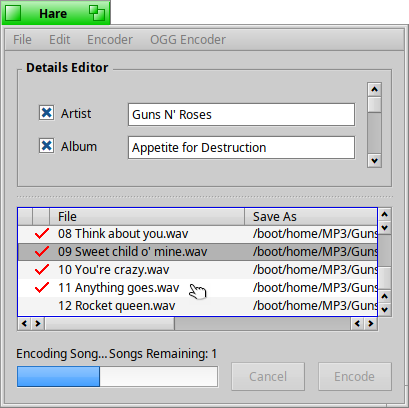

Hare
====

Hare - Haiku Audio Ripper Encoder

Hare is now usable, but unstable, and not yet feature complete.  There is work being done to correct this.  Stay tuned.

Bug reports and feature requests can be reported at https://github.com/HaikuArchives/Hare/issues
